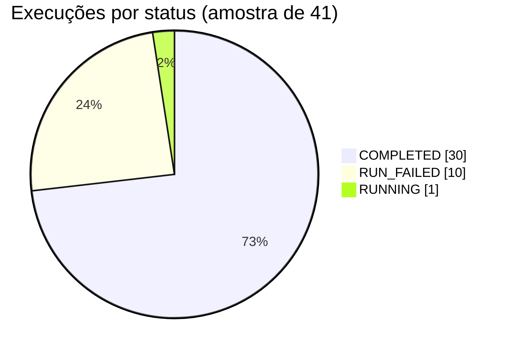
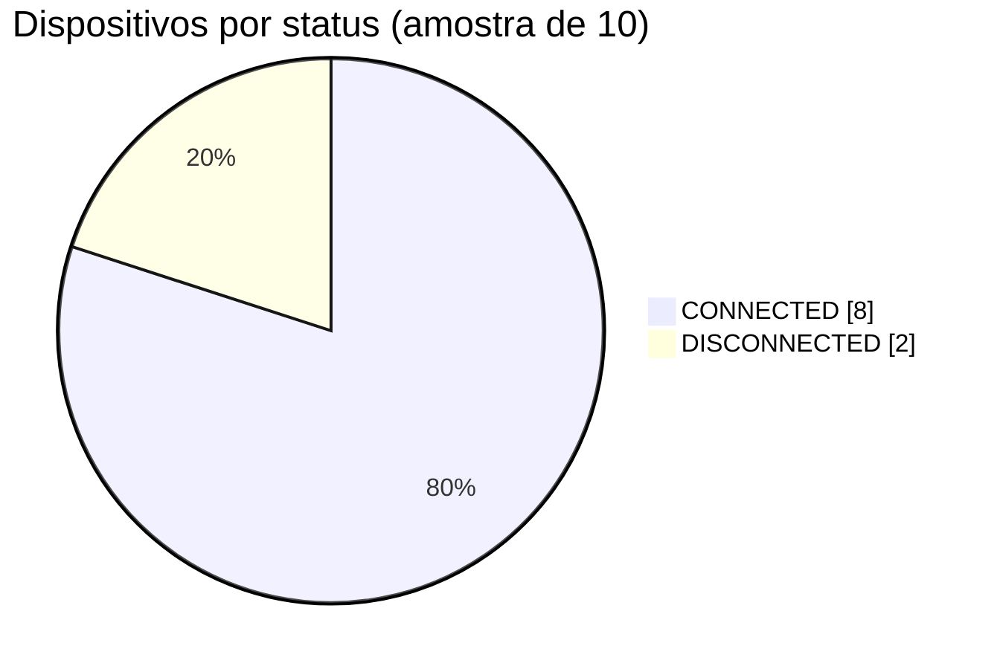
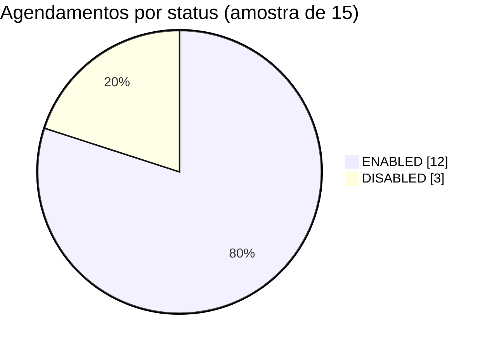
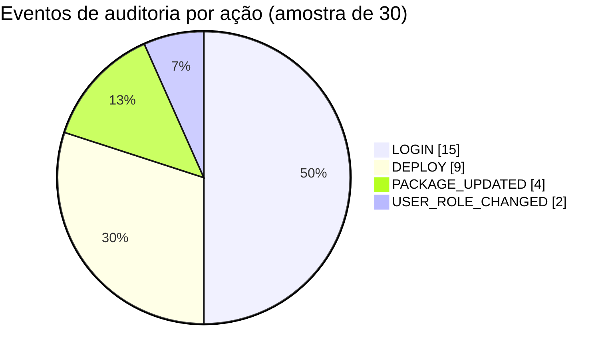
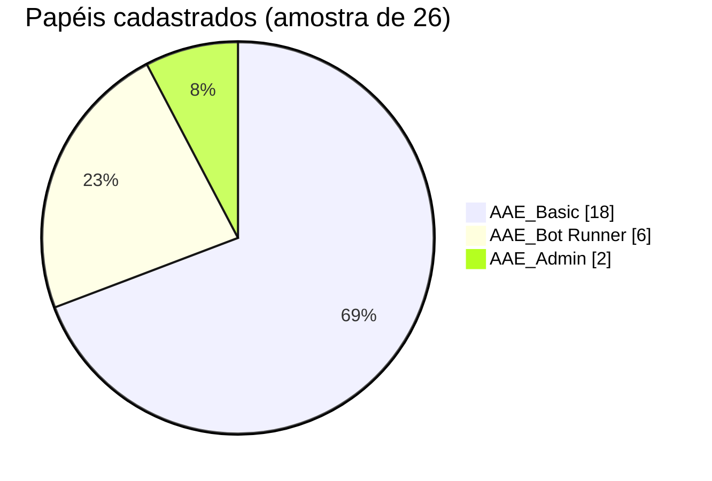

# Documentação da API — Automation Anywhere Control Room

- **Gerado em:** 2026-10-05 16:13:20 UTC
- **Control Room:** `mock://exemplo`
- **Usuário usado na coleta:** `usuario.exemplo`
- **Itens de lista por chamada:** 5 (truncado de propósito)

> ⚠️ **RELATÓRIO DE EXEMPLO (`--mock`)** — todos os dados abaixo são fictícios, gerados sem conexão com nenhuma Control Room real. Serve só para mostrar o formato do relatório.

## Como ler este relatório

Para cada chamada da API você encontra, nesta ordem:

1. **O que é** — descrição em linguagem simples.
2. **📊 O que monitorar** — perguntas de negócio/operação que esse retorno ajuda a responder.
3. **Gráfico de exemplo**, quando aplicável — agregado a partir de uma amostra maior (nunca um registro individual real).
4. **Como chamar em Python** — trecho pronto para copiar.
5. **Campos observados** e uma **amostra da resposta** (pequena, redigida).

## Sumário

| Categoria | Endpoint | Método | Caminho | Status |
|---|---|---|---|---|
| Activity | Lista execuções (deployments) de bots, com paginação. | `POST` | `/v3/activity/list` | ✅ OK |
| Activity | Detalhe de uma execução específica. | `GET` | `/v3/activity/execution/123456789012345` | ✅ OK |
| Activity | [AÇÃO] Dispara a execução (deploy) de uma automação em um ou mais dispositivos. | `POST` | `/v3/automations/deploy` | ⚠️ Ação (documentada, não executada) |
| Activity | [AÇÃO] Interrompe (stop) uma execução em andamento. | `PUT` | `/v2/activity/stop/{activityId}` | ⚠️ Ação (documentada, não executada) |
| Activity | [AÇÃO] Pausa ou retoma uma execução em andamento (action = pause|resume). | `PUT` | `/v2/activity/{action}/{activityId}` | ⚠️ Ação (documentada, não executada) |
| Dispositivos (Devices) | Lista os dispositivos (Bot Runners / máquinas) registrados. | `GET` | `/v2/devices/list?page=0&size=5` | ✅ OK |
| Dispositivos (Devices) | Lista os Device Pools (grupos de dispositivos). | `GET` | `/v1/devices/pools/list?page=0&size=5` | ✅ OK |
| Agendamentos (Scheduler) | Lista as regras de agendamento configuradas. | `GET` | `/v2/schedule/rules/list?page=0&size=5` | ✅ OK |
| Agendamentos (Scheduler) | [AÇÃO] Habilita/desabilita uma regra de agendamento. | `PATCH` | `/v2/schedule/rules/{scheduleId}` | ⚠️ Ação (documentada, não executada) |
| Repositório | Lista os workspaces (Public/Private) do Repositório. | `GET` | `/v2/repository/workspaces` | ✅ OK |
| Repositório | Lista pastas do Repositório. | `POST` | `/v2/repository/folders/list` | ✅ OK |
| Repositório | Lista arquivos (bots/tasks) do Repositório. | `POST` | `/v2/repository/files/list` | ✅ OK |
| Pacotes (Packages) | Lista os pacotes (comandos/plugins) instalados na Control Room. | `GET` | `/v2/packages/list?page=0&size=5` | ✅ OK |
| Auditoria | Lista eventos de auditoria (quem fez o quê, quando). | `GET` | `/v2/audit/logs?page=0&size=5` | ✅ OK |
| Políticas (Policy) | Lista políticas de controle (ex.: restrições de execução). | `GET` | `/v3/policies?page=0&size=5` | ✅ OK |
| Workload Management (WLM) | Lista filas de trabalho do Workload Management. | `GET` | `/v2/wlm/queues?page=0&size=5` | ✅ OK |
| AARI / ACC | Resumo do módulo AARI/ACC (interação humano-bot), se licenciado. | `GET` | `/v2/acc/summary` | ✅ OK |
| Bot Insight | Resumo de métricas do Bot Insight, se licenciado. | `GET` | `/v2/insight/summary` | ✅ OK |
| Usuários | Busca/lista usuários da Control Room. | `POST` | `/v1/usermanagement/users/list` | ✅ OK |
| Usuários | Lista papéis (roles) configurados. | `GET` | `/v1/usermanagement/roles/list?page=0&size=5` | ✅ OK |
| Cofre de Credenciais | Lista credenciais cadastradas no Cofre (metadados — nunca o valor secreto). | `GET` | `/v2/credentialvault/credentials?page=0&size=5` | ✅ OK |
| Cofre de Credenciais | [AÇÃO] Cria uma nova credencial no Cofre. | `POST` | `/v2/credentialvault/credentials` | ⚠️ Ação (documentada, não executada) |

## Como autenticar

Toda chamada documentada abaixo assume que você já executou isto uma vez:

```python
import requests

base_url = "https://sua-control-room.exemplo.com"  # SEM barra no final
proxies = None
verify_tls = True

# Se sua rede exige saída via proxy HTTP corporativo para alcançar a
# Control Room, descomente as linhas abaixo. Alguns proxies corporativos
# fazem inspeção de TLS (reemitem um certificado próprio no meio do túnel);
# se esse certificado tiver algum defeito que o OpenSSL rejeite mesmo sendo
# aceito pelo seu sistema operacional, pode ser necessário desligar a
# verificação SÓ nesta chamada via proxy — nunca em conexão direta.
#
# proxies = {"http": "http://proxy.empresa.com:80", "https": "http://proxy.empresa.com:80"}
# verify_tls = False

session = requests.Session()
if proxies:
    session.proxies = proxies
session.verify = verify_tls

resp = session.post(
    f"{base_url}/v2/authentication",
    json={"username": "SEU_USUARIO", "apiKey": "SUA_API_KEY"},
    timeout=20,
)
resp.raise_for_status()
token = resp.json()["token"]

# Toda chamada seguinte usa este header — NUNCA "Authorization: Bearer ...".
session.headers.update({"X-Authorization": token})
```

## Activity

### Lista execuções (deployments) de bots, com paginação.

`POST /v3/activity/list`

Equivalente à aba 'Activity' da Control Room. `page` é um OBJETO `{offset, length}` — mandar um número solto devolve HTTP 400 (json.deserialization.exception), erro já visto em produção.

**Notas:** Campos de data vêm como `startDateTime`/`endDateTime` (ISO 8601), não `started`/`ended`. Não existe campo de duração pronto — calcule a diferença entre os dois timestamps.

**📊 O que monitorar com este retorno:**

- Taxa de sucesso vs. erro por automação — a base de qualquer painel de saúde de RPA.
- Duração média/p95 por automação, para detectar degradação de performance antes que vire SLA estourado.
- Volume de execuções por hora/dia, para achar picos e janelas de manutenção seguras.
- Ranking de automações/dispositivos com mais falhas recentes, para priorizar correção.

**Status nesta coleta:** ✅ OK (HTTP 200)

**📈 Gráfico de exemplo** (agregado a partir de uma amostra maior, sem expor registro individual):



```
Execuções por dia (amostra)

2026-01-01  ████████████████████████████████ 4
2026-01-02  ████████████████████████████████ 4
2026-01-03  ████████████████████████████████ 4
2026-01-04  ████████████████████████████████ 4
2026-01-05  ████████████████████████████████ 4
2026-01-06  ████████████████████████████████ 4
2026-01-07  ████████████████████████████████ 4
2026-01-08  ████████████████████████████████ 4
2026-01-09  ████████████████████████████████ 4
2026-01-10  ████████████████████████████████████████ 5
```

Para reproduzir com o histórico completo (não só a amostra):

```python
import matplotlib.pyplot as plt
from collections import Counter

# `items` = lista completa de activity.list (pagine até ter o período que
# quiser — veja a paginação em "Como chamar em Python" acima).
status_counts = Counter(item["status"] for item in items)

fig, ax = plt.subplots()
ax.pie(status_counts.values(), labels=status_counts.keys(), autopct="%1.0f%%")
ax.set_title("Execuções por status")
plt.savefig("execucoes_por_status.png")
```

**Como chamar em Python:**

```python
# Lista execuções (deployments) de bots, com paginação.
body = {'sort': [], 'page': {'offset': 0, 'length': 5}}
resp = session.post(f"{base_url}/v3/activity/list", json=body, timeout=20)
resp.raise_for_status()
data = resp.json()
```

**Campos observados na resposta real:**

| Campo | Tipo | Exemplo |
|---|---|---|
| `page` | object |  |
| `page.offset` | integer | 0 |
| `page.total` | integer | 2 |
| `page.totalElements` | integer | 2 |
| `list` | array |  |
| `list[].id` | string | 123456789012345 |
| `list[].automationName` | string | Exemplo_ProcessarFaturas |
| `list[].status` | string | COMPLETED |
| `list[].startDateTime` | string | 2026-01-10T08:00:00Z |
| `list[].endDateTime` | string | 2026-01-10T08:04:12Z |
| `list[].deviceName` | string | BOTRUNNER-EXEMPLO-01 |
| `list[].botRunnerUserId` | integer | 42 |
| `list[].workDeviceId` | integer | 7 |

**Amostra da resposta (truncada, campos sensíveis redigidos):**

```json
{
  "page": {
    "offset": 0,
    "total": 2,
    "totalElements": 2
  },
  "list": [
    {
      "id": "123456789012345",
      "automationName": "Exemplo_ProcessarFaturas",
      "status": "COMPLETED",
      "startDateTime": "2026-01-10T08:00:00Z",
      "endDateTime": "2026-01-10T08:04:12Z",
      "deviceName": "BOTRUNNER-EXEMPLO-01",
      "botRunnerUserId": 42,
      "workDeviceId": 7
    }
  ]
}
```

### Detalhe de uma execução específica.

`GET /v3/activity/execution/123456789012345`

Mesmo formato de item da Activity List, para um `activityId` específico.

**Notas:** O gerador usa automaticamente o primeiro ID retornado por activity.list, se houver.

**📊 O que monitorar com este retorno:**

- Drill-down a partir de um alerta: ver o detalhe exato de uma execução específica que apareceu como falha/atrasada no painel agregado.

**Status nesta coleta:** ✅ OK (HTTP 200)

**Como chamar em Python:**

```python
# Detalhe de uma execução específica.
resp = session.get(f"{base_url}/v3/activity/execution/123456789012345", timeout=20)
resp.raise_for_status()
data = resp.json()
```

**Campos observados na resposta real:**

| Campo | Tipo | Exemplo |
|---|---|---|
| `id` | string | 123456789012345 |
| `automationName` | string | Exemplo_ProcessarFaturas |
| `status` | string | COMPLETED |
| `startDateTime` | string | 2026-01-10T08:00:00Z |
| `endDateTime` | string | 2026-01-10T08:04:12Z |
| `deviceName` | string | BOTRUNNER-EXEMPLO-01 |

**Amostra da resposta (truncada, campos sensíveis redigidos):**

```json
{
  "id": "123456789012345",
  "automationName": "Exemplo_ProcessarFaturas",
  "status": "COMPLETED",
  "startDateTime": "2026-01-10T08:00:00Z",
  "endDateTime": "2026-01-10T08:04:12Z",
  "deviceName": "BOTRUNNER-EXEMPLO-01"
}
```

### [AÇÃO] Dispara a execução (deploy) de uma automação em um ou mais dispositivos.

`POST /v3/automations/deploy`  —  **[AÇÃO — modifica estado, nunca executada automaticamente]**

Inicia um bot de verdade em produção. Esta ferramenta NUNCA chama este endpoint automaticamente — só documenta o formato esperado do corpo da requisição.

**📊 O que monitorar com este retorno:**

- Base para auto-remediação: disparar de novo uma automação que falhou por motivo transitório (ex.: VM fora do ar), a partir de um alerta do seu próprio painel.

**Status nesta coleta:** ⚠️ Ação (documentada, não executada)

**Corpo esperado da requisição (documentado — confira contra a versão da sua Control Room antes de usar):**

| Campo | Tipo | Descrição |
|---|---|---|
| `fileId` | number | ID do arquivo/automação no Repositório a ser executado. |
| `runAsUserIds` | array<number> | IDs dos usuários cujas credenciais de Device rodam o bot. |
| `poolIds` | array<number> | IDs de Device Pools onde distribuir a execução (alternativa a deviceIds). |
| `deviceIds` | array<number> | IDs de devices específicos (alternativa a poolIds). |
| `botInput` | object | Parâmetros de entrada do bot, como um dicionário de variáveis tipadas. |


### [AÇÃO] Interrompe (stop) uma execução em andamento.

`PUT /v2/activity/stop/{activityId}`  —  **[AÇÃO — modifica estado, nunca executada automaticamente]**

Encerra à força uma automação rodando. Nunca executado automaticamente por esta ferramenta.

**📊 O que monitorar com este retorno:**

- Botão de emergência a partir de um alerta de 'execução presa' (duração muito acima do normal).

**Status nesta coleta:** ⚠️ Ação (documentada, não executada)


### [AÇÃO] Pausa ou retoma uma execução em andamento (action = pause|resume).

`PUT /v2/activity/{action}/{activityId}`  —  **[AÇÃO — modifica estado, nunca executada automaticamente]**

Nunca executado automaticamente por esta ferramenta.

**Status nesta coleta:** ⚠️ Ação (documentada, não executada)


## Dispositivos (Devices)

### Lista os dispositivos (Bot Runners / máquinas) registrados.

`GET /v2/devices/list?page=0&size=5`

Equivalente à aba 'Devices'. Traz status de conexão, pool, tipo e versão do agente.

**📊 O que monitorar com este retorno:**

- Dispositivos desconectados AGORA — correlacione com Activity para saber se isso já está causando NAO_INICIOU/atrasos em automações agendadas para rodar neles.
- Distribuição de carga por pool — pools sobrecarregados (poucos devices, muita automação) viram gargalo antes de aparecer como erro.

**Status nesta coleta:** ✅ OK (HTTP 200)

**📈 Gráfico de exemplo** (agregado a partir de uma amostra maior, sem expor registro individual):



Para reproduzir com o histórico completo (não só a amostra):

```python
import matplotlib.pyplot as plt
from collections import Counter

status_counts = Counter(item["status"] for item in items)
fig, ax = plt.subplots()
ax.bar(status_counts.keys(), status_counts.values())
ax.set_ylabel("Dispositivos")
plt.savefig("dispositivos_por_status.png")
```

**Como chamar em Python:**

```python
# Lista os dispositivos (Bot Runners / máquinas) registrados.
resp = session.get(f"{base_url}/v2/devices/list?page=0&size=5", timeout=20)
resp.raise_for_status()
data = resp.json()
```

**Campos observados na resposta real:**

| Campo | Tipo | Exemplo |
|---|---|---|
| `page` | object |  |
| `page.totalElements` | integer | 1 |
| `list` | array |  |
| `list[].id` | integer | 7 |
| `list[].hostName` | string | BOTRUNNER-EXEMPLO-01 |
| `list[].status` | string | CONNECTED |
| `list[].type` | string | BOT_RUNNER |
| `list[].poolName` | string | Pool Exemplo |
| `list[].osVersion` | string | Windows Server 2019 |

**Amostra da resposta (truncada, campos sensíveis redigidos):**

```json
{
  "page": {
    "totalElements": 1
  },
  "list": [
    {
      "id": 7,
      "hostName": "BOTRUNNER-EXEMPLO-01",
      "status": "CONNECTED",
      "type": "BOT_RUNNER",
      "poolName": "Pool Exemplo",
      "osVersion": "Windows Server 2019"
    }
  ]
}
```

### Lista os Device Pools (grupos de dispositivos).

`GET /v1/devices/pools/list?page=0&size=5`

Pools são usados para distribuir execuções entre várias máquinas.

**📊 O que monitorar com este retorno:**

- Pools com poucos dispositivos ativos relativos à automação agendada para eles — risco de fila.

**Status nesta coleta:** ✅ OK (HTTP 200)

**Como chamar em Python:**

```python
# Lista os Device Pools (grupos de dispositivos).
resp = session.get(f"{base_url}/v1/devices/pools/list?page=0&size=5", timeout=20)
resp.raise_for_status()
data = resp.json()
```

**Campos observados na resposta real:**

| Campo | Tipo | Exemplo |
|---|---|---|
| `list` | array |  |
| `list[].id` | integer | 1 |
| `list[].name` | string | Pool Exemplo |
| `list[].deviceCount` | integer | 1 |

**Amostra da resposta (truncada, campos sensíveis redigidos):**

```json
{
  "list": [
    {
      "id": 1,
      "name": "Pool Exemplo",
      "deviceCount": 1
    }
  ]
}
```

## Agendamentos (Scheduler)

### Lista as regras de agendamento configuradas.

`GET /v2/schedule/rules/list?page=0&size=5`

Cada regra liga uma automação a um calendário (cron/recorrência) e a dispositivos/pools de destino.

**📊 O que monitorar com este retorno:**

- Agendamentos desabilitados que deveriam estar ativos (ou vice-versa) — causa clássica de 'a automação simplesmente não rodou hoje' sem nenhum erro nos logs.
- Cruzar com Activity: todo agendamento ENABLED deveria ter uma execução correspondente no horário esperado — ausência = alerta de NAO_INICIOU.

**Status nesta coleta:** ✅ OK (HTTP 200)

**📈 Gráfico de exemplo** (agregado a partir de uma amostra maior, sem expor registro individual):



**Como chamar em Python:**

```python
# Lista as regras de agendamento configuradas.
resp = session.get(f"{base_url}/v2/schedule/rules/list?page=0&size=5", timeout=20)
resp.raise_for_status()
data = resp.json()
```

**Campos observados na resposta real:**

| Campo | Tipo | Exemplo |
|---|---|---|
| `list` | array |  |
| `list[].id` | integer | 55 |
| `list[].name` | string | Exemplo_Agendamento_Diario |
| `list[].fileId` | integer | 901 |
| `list[].status` | string | ENABLED |
| `list[].cronString` | string | 0 6 * * * |

**Amostra da resposta (truncada, campos sensíveis redigidos):**

```json
{
  "list": [
    {
      "id": 55,
      "name": "Exemplo_Agendamento_Diario",
      "fileId": 901,
      "status": "ENABLED",
      "cronString": "0 6 * * *"
    }
  ]
}
```

### [AÇÃO] Habilita/desabilita uma regra de agendamento.

`PATCH /v2/schedule/rules/{scheduleId}`  —  **[AÇÃO — modifica estado, nunca executada automaticamente]**

Nunca executado automaticamente por esta ferramenta.

**Status nesta coleta:** ⚠️ Ação (documentada, não executada)

**Corpo esperado da requisição (documentado — confira contra a versão da sua Control Room antes de usar):**

| Campo | Tipo | Descrição |
|---|---|---|
| `enabled` | boolean | true para habilitar, false para desabilitar. |


## Repositório

### Lista os workspaces (Public/Private) do Repositório.

`GET /v2/repository/workspaces`

Workspace é o nível mais alto de organização de pastas/arquivos de automação.

**📊 O que monitorar com este retorno:**

- Inventário: quantos workspaces existem e qual o volume de automações em cada um.

**Status nesta coleta:** ✅ OK (HTTP 200)

**Como chamar em Python:**

```python
# Lista os workspaces (Public/Private) do Repositório.
resp = session.get(f"{base_url}/v2/repository/workspaces", timeout=20)
resp.raise_for_status()
data = resp.json()
```

**Campos observados na resposta real:**

| Campo | Tipo | Exemplo |
|---|---|---|
| `list` | array |  |
| `list[].id` | integer | 1 |
| `list[].name` | string | Public |
| `list[].type` | string | PUBLIC |

**Amostra da resposta (truncada, campos sensíveis redigidos):**

```json
{
  "list": [
    {
      "id": 1,
      "name": "Public",
      "type": "PUBLIC"
    }
  ]
}
```

### Lista pastas do Repositório.

`POST /v2/repository/folders/list`

Estrutura de pastas dentro de um workspace.

**Status nesta coleta:** ✅ OK (HTTP 200)

**Como chamar em Python:**

```python
# Lista pastas do Repositório.
body = {'sort': [], 'page': {'offset': 0, 'length': 5}}
resp = session.post(f"{base_url}/v2/repository/folders/list", json=body, timeout=20)
resp.raise_for_status()
data = resp.json()
```

**Campos observados na resposta real:**

| Campo | Tipo | Exemplo |
|---|---|---|
| `list` | array |  |
| `list[].id` | integer | 10 |
| `list[].name` | string | Processos Financeiro |
| `list[].parentId` | integer | 1 |

**Amostra da resposta (truncada, campos sensíveis redigidos):**

```json
{
  "list": [
    {
      "id": 10,
      "name": "Processos Financeiro",
      "parentId": 1
    }
  ]
}
```

### Lista arquivos (bots/tasks) do Repositório.

`POST /v2/repository/files/list`

Cada item representa uma automação armazenada — nome, tipo, pasta, última modificação.

**📊 O que monitorar com este retorno:**

- Automações nunca modificadas há muito tempo rodando em produção — candidatas a revisão técnica.
- Inventário completo para cruzar com Activity List e achar automações cadastradas que nunca tiveram execução (RPA 'fantasma').

**Status nesta coleta:** ✅ OK (HTTP 200)

**Como chamar em Python:**

```python
# Lista arquivos (bots/tasks) do Repositório.
body = {'sort': [], 'page': {'offset': 0, 'length': 5}}
resp = session.post(f"{base_url}/v2/repository/files/list", json=body, timeout=20)
resp.raise_for_status()
data = resp.json()
```

**Campos observados na resposta real:**

| Campo | Tipo | Exemplo |
|---|---|---|
| `list` | array |  |
| `list[].id` | integer | 901 |
| `list[].name` | string | Exemplo_ProcessarFaturas |
| `list[].type` | string | TASK_BOT |
| `list[].folderId` | integer | 10 |

**Amostra da resposta (truncada, campos sensíveis redigidos):**

```json
{
  "list": [
    {
      "id": 901,
      "name": "Exemplo_ProcessarFaturas",
      "type": "TASK_BOT",
      "folderId": 10
    }
  ]
}
```

## Pacotes (Packages)

### Lista os pacotes (comandos/plugins) instalados na Control Room.

`GET /v2/packages/list?page=0&size=5`

Inclui nome, versão e se o pacote está habilitado.

**📊 O que monitorar com este retorno:**

- Pacotes desatualizados — mesma lógica do 'dependencyStatus' do painel principal: cruzar versão do pacote com o histórico de erro das automações que o usam.

**Status nesta coleta:** ✅ OK (HTTP 200)

**Como chamar em Python:**

```python
# Lista os pacotes (comandos/plugins) instalados na Control Room.
resp = session.get(f"{base_url}/v2/packages/list?page=0&size=5", timeout=20)
resp.raise_for_status()
data = resp.json()
```

**Campos observados na resposta real:**

| Campo | Tipo | Exemplo |
|---|---|---|
| `list` | array |  |
| `list[].name` | string | Excel Advanced Package |
| `list[].version` | string | 25.1.0 |
| `list[].enabled` | boolean | True |

**Amostra da resposta (truncada, campos sensíveis redigidos):**

```json
{
  "list": [
    {
      "name": "Excel Advanced Package",
      "version": "25.1.0",
      "enabled": true
    }
  ]
}
```

## Auditoria

### Lista eventos de auditoria (quem fez o quê, quando).

`GET /v2/audit/logs?page=0&size=5`

Cobre login, deploy, alterações de usuário/papel, mudanças de pacote, etc., conforme a versão.

**📊 O que monitorar com este retorno:**

- Quem alterou/fez deploy de uma automação pouco antes dela começar a falhar — correlação causa-efeito direta com a aba Activity.
- Volume de ações por usuário/dia — detecta automação de terceiros (script rodando com conta de serviço fora do horário esperado).

**Status nesta coleta:** ✅ OK (HTTP 200)

**📈 Gráfico de exemplo** (agregado a partir de uma amostra maior, sem expor registro individual):



**Como chamar em Python:**

```python
# Lista eventos de auditoria (quem fez o quê, quando).
resp = session.get(f"{base_url}/v2/audit/logs?page=0&size=5", timeout=20)
resp.raise_for_status()
data = resp.json()
```

**Campos observados na resposta real:**

| Campo | Tipo | Exemplo |
|---|---|---|
| `list` | array |  |
| `list[].timestamp` | string | 2026-01-10T08:00:00Z |
| `list[].userName` | string | svc_exemplo |
| `list[].action` | string | DEPLOY |
| `list[].targetName` | string | Exemplo_ProcessarFaturas |

**Amostra da resposta (truncada, campos sensíveis redigidos):**

```json
{
  "list": [
    {
      "timestamp": "2026-01-10T08:00:00Z",
      "userName": "svc_exemplo",
      "action": "DEPLOY",
      "targetName": "Exemplo_ProcessarFaturas"
    }
  ]
}
```

## Políticas (Policy)

### Lista políticas de controle (ex.: restrições de execução).

`GET /v3/policies?page=0&size=5`

Recurso licenciado separadamente — normal responder 403 (FORBIDDEN) se não estiver habilitado.

**📊 O que monitorar com este retorno:**

- Se licenciado: quais restrições de execução (horário/dispositivo) estão ativas e para quem.

**Status nesta coleta:** ✅ OK (HTTP 200)

**Como chamar em Python:**

```python
# Lista políticas de controle (ex.: restrições de execução).
resp = session.get(f"{base_url}/v3/policies?page=0&size=5", timeout=20)
resp.raise_for_status()
data = resp.json()
```

**Campos observados na resposta real:**

| Campo | Tipo | Exemplo |
|---|---|---|
| `list` | array |  |

**Amostra da resposta (truncada, campos sensíveis redigidos):**

```json
{
  "list": []
}
```

## Workload Management (WLM)

### Lista filas de trabalho do Workload Management.

`GET /v2/wlm/queues?page=0&size=5`

Recurso licenciado separadamente — normal responder UNAVAILABLE se o módulo não existir.

**📊 O que monitorar com este retorno:**

- Se licenciado: profundidade de fila (itens pendentes) como sinal antecipado de atraso.

**Status nesta coleta:** ✅ OK (HTTP 200)

**Como chamar em Python:**

```python
# Lista filas de trabalho do Workload Management.
resp = session.get(f"{base_url}/v2/wlm/queues?page=0&size=5", timeout=20)
resp.raise_for_status()
data = resp.json()
```

**Campos observados na resposta real:**

| Campo | Tipo | Exemplo |
|---|---|---|
| `list` | array |  |

**Amostra da resposta (truncada, campos sensíveis redigidos):**

```json
{
  "list": []
}
```

## AARI / ACC

### Resumo do módulo AARI/ACC (interação humano-bot), se licenciado.

`GET /v2/acc/summary`

Recurso licenciado separadamente.

**Status nesta coleta:** ✅ OK (HTTP 200)

**Como chamar em Python:**

```python
# Resumo do módulo AARI/ACC (interação humano-bot), se licenciado.
resp = session.get(f"{base_url}/v2/acc/summary", timeout=20)
resp.raise_for_status()
data = resp.json()
```

**Amostra da resposta (truncada, campos sensíveis redigidos):**

```json
{}
```

## Bot Insight

### Resumo de métricas do Bot Insight, se licenciado.

`GET /v2/insight/summary`

Recurso licenciado separadamente.

**Status nesta coleta:** ✅ OK (HTTP 200)

**Como chamar em Python:**

```python
# Resumo de métricas do Bot Insight, se licenciado.
resp = session.get(f"{base_url}/v2/insight/summary", timeout=20)
resp.raise_for_status()
data = resp.json()
```

**Amostra da resposta (truncada, campos sensíveis redigidos):**

```json
{}
```

## Usuários

### Busca/lista usuários da Control Room.

`POST /v1/usermanagement/users/list`

Diferente das demais 'List API' (que aceitam GET), a busca de usuários é POST — confirmado em produção.

**📊 O que monitorar com este retorno:**

- Contas de usuário desabilitadas ainda com papéis sensíveis atribuídos (higiene de acesso).
- Quantos usuários humanos vs. contas de serviço — útil para dimensionar licenciamento.

**Status nesta coleta:** ✅ OK (HTTP 200)

**Como chamar em Python:**

```python
# Busca/lista usuários da Control Room.
body = {'sort': [], 'page': {'offset': 0, 'length': 5}}
resp = session.post(f"{base_url}/v1/usermanagement/users/list", json=body, timeout=20)
resp.raise_for_status()
data = resp.json()
```

**Campos observados na resposta real:**

| Campo | Tipo | Exemplo |
|---|---|---|
| `list` | array |  |
| `list[].id` | integer | 1 |
| `list[].username` | string | exemplo.usuario |
| `list[].email` | string | exemplo@empresa.local |
| `list[].disabled` | boolean | False |

**Amostra da resposta (truncada, campos sensíveis redigidos):**

```json
{
  "list": [
    {
      "id": 1,
      "username": "exemplo.usuario",
      "email": "exemplo@empresa.local",
      "disabled": false
    }
  ]
}
```

### Lista papéis (roles) configurados.

`GET /v1/usermanagement/roles/list?page=0&size=5`

Cada papel agrega um conjunto de licenças/permissões atribuível a usuários.

**📊 O que monitorar com este retorno:**

- Distribuição de usuários por papel — concentração de poder (muitos AAE_Admin) é um risco de governança.

**Status nesta coleta:** ✅ OK (HTTP 200)

**📈 Gráfico de exemplo** (agregado a partir de uma amostra maior, sem expor registro individual):



**Como chamar em Python:**

```python
# Lista papéis (roles) configurados.
resp = session.get(f"{base_url}/v1/usermanagement/roles/list?page=0&size=5", timeout=20)
resp.raise_for_status()
data = resp.json()
```

**Campos observados na resposta real:**

| Campo | Tipo | Exemplo |
|---|---|---|
| `list` | array |  |
| `list[].id` | integer | 2 |
| `list[].name` | string | AAE_Basic |

**Amostra da resposta (truncada, campos sensíveis redigidos):**

```json
{
  "list": [
    {
      "id": 2,
      "name": "AAE_Basic"
    }
  ]
}
```

## Cofre de Credenciais

### Lista credenciais cadastradas no Cofre (metadados — nunca o valor secreto).

`GET /v2/credentialvault/credentials?page=0&size=5`

A API nunca devolve o valor da credencial em texto puro, só metadados (nome, dono, atributos).

**📊 O que monitorar com este retorno:**

- Credenciais sem dono claro ou não usadas por nenhuma automação ativa (candidatas a revogação).

**Status nesta coleta:** ✅ OK (HTTP 200)

**Como chamar em Python:**

```python
# Lista credenciais cadastradas no Cofre (metadados — nunca o valor secreto).
resp = session.get(f"{base_url}/v2/credentialvault/credentials?page=0&size=5", timeout=20)
resp.raise_for_status()
data = resp.json()
```

**Campos observados na resposta real:**

| Campo | Tipo | Exemplo |
|---|---|---|
| `list` | array |  |
| `list[].id` | integer | 3 |
| `list[].name` | string | Credencial Exemplo |
| `list[].owner` | string | exemplo.usuario |

**Amostra da resposta (truncada, campos sensíveis redigidos):**

```json
{
  "list": [
    {
      "id": 3,
      "name": "Credencial Exemplo",
      "owner": "exemplo.usuario"
    }
  ]
}
```

### [AÇÃO] Cria uma nova credencial no Cofre.

`POST /v2/credentialvault/credentials`  —  **[AÇÃO — modifica estado, nunca executada automaticamente]**

Nunca executado automaticamente por esta ferramenta.

**Status nesta coleta:** ⚠️ Ação (documentada, não executada)

**Corpo esperado da requisição (documentado — confira contra a versão da sua Control Room antes de usar):**

| Campo | Tipo | Descrição |
|---|---|---|
| `name` | string | Nome da credencial. |
| `description` | string | Descrição opcional. |
| `attributes` | array<object> | Lista de atributos {name, type, value/masked}. |

